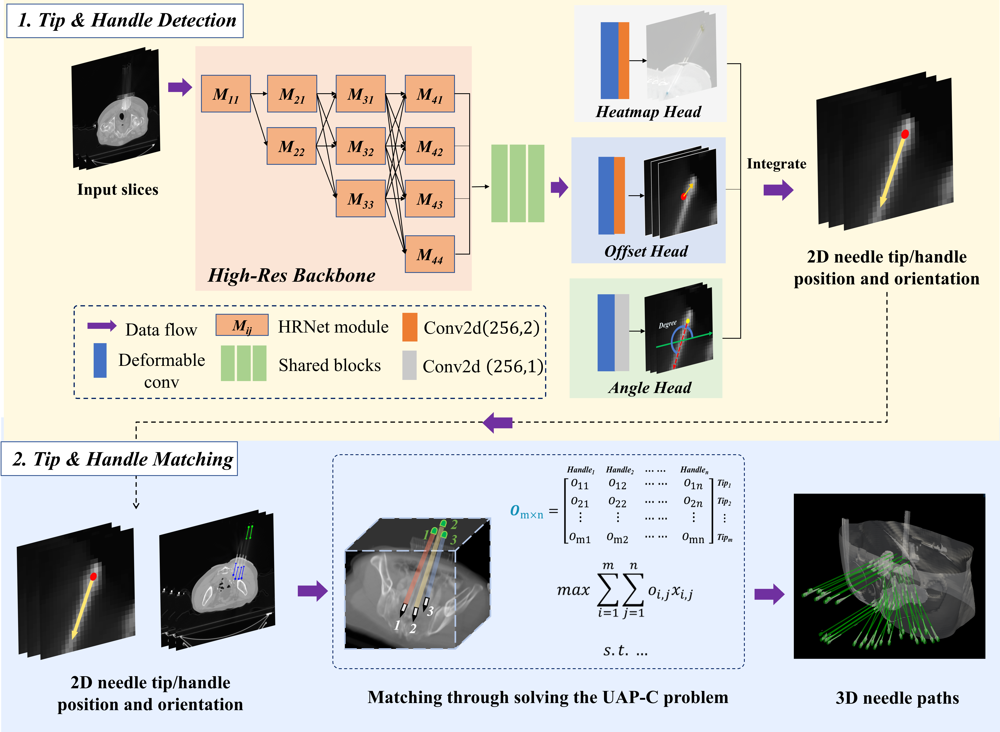
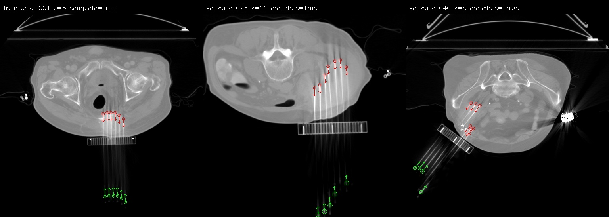

# CTNeedleLocalization

[](https://doi.org/10.1109/JBHI.2026.3694701)

## 🎬 TPS Demo


https://github.com/user-attachments/assets/68396c2a-b2ca-4534-992c-4828db23886a


---

🎉 **News:** This work has been officially accepted by the **IEEE Journal of Biomedical and Health Informatics (JBHI)**!

Official Code of  **“Multi-needle Localization for Pelvic Seed Implant Brachytherapy based on Tip-handle Detection and Matching”**

---

## 📝 Citation

If you find this work or code useful for your research, please cite our paper:

```bibtex
@ARTICLE{11523703,
  author={Xiao, Zhuo and Zhou, Fugen and Wang, Jingjing and He, Chongyu and Liu, Bo and Sun, Haitao and Ji, Zhe and Jiang, Yuliang and Wang, Junjie and Wu, Qiuwen},
  journal={IEEE Journal of Biomedical and Health Informatics},
  title={Multi-needle Localization for Pelvic Seed Implant Brachytherapy based on Tip-handle Detection and Matching},
  year={2026},
  volume={},
  number={},
  pages={1-14},
  keywords={Multi-needle localization;object detection;CT images;unbalanced assignment problem with constraints;brachytherapy},
  doi={10.1109/JBHI.2026.3694701}
}
```

---

## 📌 Overview

This repository provides a complete pipeline for **automatic multi-needle localization in intraoperative CT** for pelvic seed implant brachytherapy.

The framework consists of two stages:

1. **2D Detection**  
   Slice-wise detection of needle tips and handles.

2. **3D Matching and Reconstruction**  
   Greedy matching and merging of tip–handle pairs to reconstruct full 3D needle trajectories.

---

## 🔄 Workflow

The overall workflow of the proposed method is illustrated below.



The pipeline starts from intraoperative CT acquisition, followed by slice-wise 2D detection of needle tips and handles, and finally reconstructs complete 3D needle trajectories through greedy matching and merging.

---

## 1️⃣ 2D Detection

### Reference and Acknowledgement

The 2D detection module in this project is implemented with reference to the following open-source projects:

- **CircleNet**  
  https://github.com/hrlblab/CircleNet

- **CenterNet**  
  https://github.com/xingyizhou/CenterNet

- **HRNet**  
  https://github.com/HRNet/HRNet-Semantic-Segmentation

We sincerely thank the authors for making their work publicly available.

---

### Installation

Use Python 3.9 and a CUDA-compatible PyTorch 1.11 build, then install dependencies:

```bash
pip install -r requirements.txt
```

For backbone initialization, place HRNet-W48 ImageNet-pretrained weights at `weights/hrnetv2_w48_imagenet_pretrained.pth` or set `HRNET_PRETRAINED`.

### Data and training

Each source case requires `ct.nii.gz`, `label.nii.gz` (needle instance IDs), and `body.nii.gz` on the same voxel grid.

```bash
python prepare_needleseg.py --source /path/to/data_nii --window-level -100 --window-width 1700
python 2d_detection/main.py --task keyptdet --dataset needleseg --arch hrnet \
  --gpus 0 --batch_size 8 --lr 0.00025 --lr_step 90 --num_epochs 100 \
  --exp_id hrnet_needleseg_ct
```

Prepared data is saved to `2d_detection/data/needleseg/`, and checkpoints are saved to `exp/keyptdet/hrnet_needleseg_ct/`.

The annotation preview below shows needle tip and handle locations and directions on CT slices.



For validation and per-case 2D export:

```bash
python 2d_detection/main.py --task keyptdet --dataset needleseg --gpus 0 \
  --test --load_model exp/keyptdet/hrnet_needleseg_ct/model_best.pth \
  --exp_id hrnet_needleseg_ct_eval --center_thresh 0.2
```

Per-case predictions are saved to `exp/keyptdet/hrnet_needleseg_ct_eval/pred2d/`. Each prediction file references its source CT volume for subsequent 3D matching.

---

## 2️⃣ 3D Matching and Needle Reconstruction

Relevant files:

- `3d_matching/match3d_utils.py`
- `3d_matching/match3d_batch.py`

### Input Format

`match3d_batch.py` operates on a case-level directory structure:

```text
case_xxx/
├── ct.nii.gz           # Also supports ct.nii and ct.mha
└── pred_2d.json        # 2D detection results
```

---

### Usage

```bash
python 3d_matching/match3d_batch.py --root /path/to/cases_root --n_prior NUMBER_OF_NEEDLES
```

---

Run from the repository root and replace `NUMBER_OF_NEEDLES` with the known count. For per-case counts, use `--priors_json` with `{"case_id": count}`. Exported cases may reference the CT through `ct_path` instead of storing a local copy.

Adjust `--length_prior_mm` and `--length_tol_mm` for your data. Use `--help` for other pairing filters.

### Output

For each case, the module generates:

```text
pred_3d.json
```

The output contains reconstructed 3D needle trajectories, matched tip–handle pairs, scores, and unmatched endpoint diagnostics. Endpoints use continuous CT voxel coordinates.

To save interactive views, PNGs and physical LPS-coordinate VTK files:

```bash
python 3d_matching/visualize3d.py --root /path/to/cases_root
```

Open the generated `index.html` to browse results.

---

## 🧠 Pretrained Weights

- **[Google Drive](https://drive.google.com/file/d/1IkT_T7kEKCrGw80zcyGGHKTzB8FSiKAk/view?usp=sharing)**
- **[Baidu Netdisk](https://pan.baidu.com/s/1OZ2flMYOSO_9U9-133r0sA?pwd=ua8n)** (Password: `ua8n`)

---

## 📄 License

This project is released under the **MIT License**.
